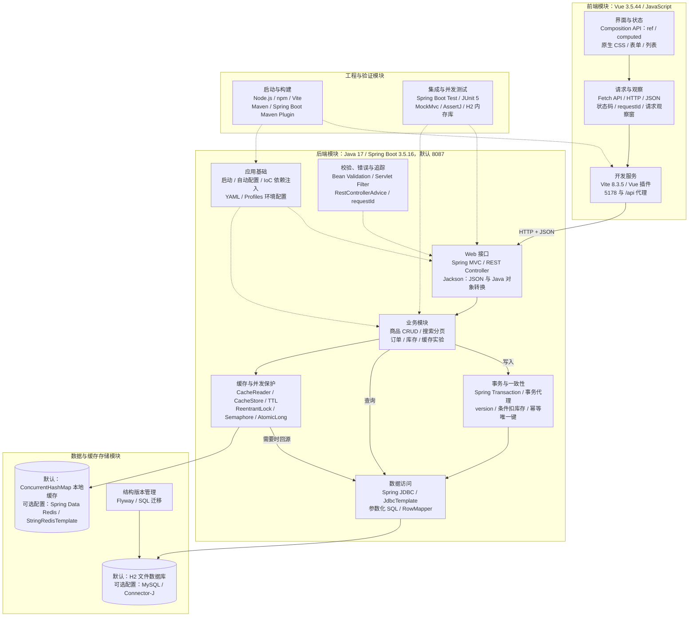
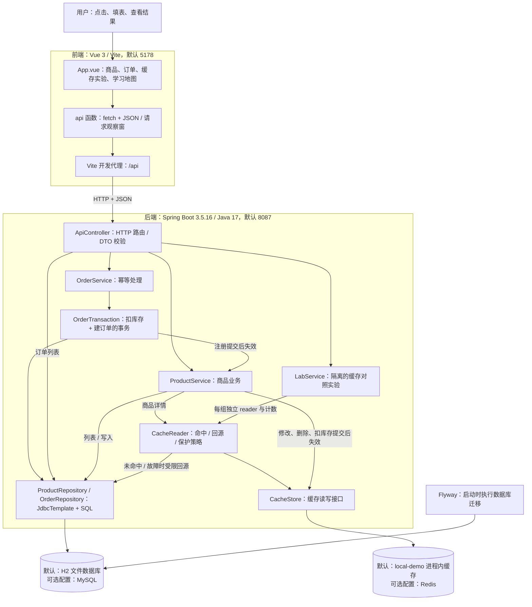
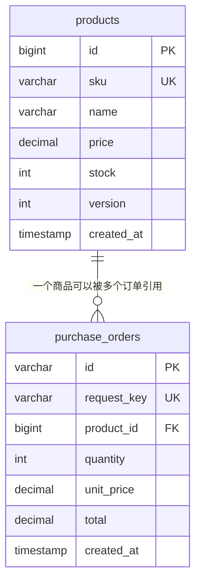

# 从页面到数据的技术架构

更新：2026-11-04，按当前源码核对。面向前端转全栈学习；页面怎样操作和观察结果，见[使用链路与模块学习说明](learning/project-architecture-and-usage.md)。

## 技术模块总图

先按技术模块看全貌，再看下一节的具体类调用。实线表示请求或数据访问主链路，虚线表示框架、保护机制与构建测试支持；图中的模块都来自当前源码或依赖声明。

数据库中的 version 条件、库存条件和唯一键由 SQL 与数据库约束执行；Spring 事务负责将相关 SQL 一起提交或回滚。这里合并为「事务与一致性」技术模块，具体实现分布在 Service、Repository 和迁移 SQL 中。

默认仍是 H2 + local-demo。MySQL、Redis 和对应 Docker Compose 配置已提供，真实服务尚未实测。工程与验证模块描述已有代码和命令，本次未执行构建或测试。

## 技术模块清单

| 技术模块 | 当前技术与机制 | 作用 / 代码依据 |
| --- | --- | --- |
| 界面与响应式状态 | Vue 3、Composition API、JavaScript、原生 CSS | `ref` 保存表单与列表，`computed` 生成展示数据；[App.vue](../client/src/App.vue)、[style.css](../client/src/style.css) |
| HTTP 客户端与观察 | 浏览器 Fetch API、JSON、状态码、requestId | `api()` 封装请求并记录响应；[App.vue](../client/src/App.vue) |
| 前端开发与构建 | Vite、@vitejs/plugin-vue、npm | 编译 Vue、提供开发服务与 `/api` 代理；[前端依赖](../client/package.json)、[Vite 配置](../client/vite.config.js) |
| 应用启动与组件装配 | Java 17、Spring Boot、IoC、构造器注入、自动配置 | 创建并连接 Controller、Service、Repository 和 CacheStore；[LabApplication](../server/src/main/java/dev/learning/lab/LabApplication.java)、[后端依赖](../server/pom.xml) |
| REST 接口与序列化 | Spring MVC、@RestController、Java record DTO、Jackson | 将 HTTP / JSON 转换为方法调用与 Java 对象，再返回 JSON；[ApiController](../server/src/main/java/dev/learning/lab/ApiController.java)、[Domain](../server/src/main/java/dev/learning/lab/Domain.java) |
| 参数校验 | Jakarta Bean Validation、@Valid、@Validated | 校验金额、库存、数量、分页和标识；[Domain](../server/src/main/java/dev/learning/lab/Domain.java)、[ApiController](../server/src/main/java/dev/learning/lab/ApiController.java) |
| 错误与请求追踪 | Servlet Filter、@RestControllerAdvice、@ExceptionHandler | 生成 requestId，统一错误码、状态和字段详情；[ApiErrors](../server/src/main/java/dev/learning/lab/ApiErrors.java) |
| 业务编排 | Spring @Service、商品 / 订单 / 实验模块 | 组织业务规则、查询、写入与实验；[ProductService](../server/src/main/java/dev/learning/lab/ProductService.java)、[OrderService](../server/src/main/java/dev/learning/lab/OrderService.java)、[LabService](../server/src/main/java/dev/learning/lab/LabService.java) |
| 事务与数据一致性 | Spring Transaction、@Transactional、提交后回调、version、条件 UPDATE、唯一键 / 外键 | 回滚失败操作、防超卖、防重复扣库存、防旧版本覆盖；[OrderTransaction](../server/src/main/java/dev/learning/lab/OrderTransaction.java)、[ProductRepository](../server/src/main/java/dev/learning/lab/ProductRepository.java)、[迁移 SQL](../server/src/main/resources/db/migration/V1__catalog_and_orders.sql) |
| SQL 数据访问 | Spring JDBC、JdbcTemplate、RowMapper、参数绑定 | 显式读写 SQL，映射商品与订单对象；[ProductRepository](../server/src/main/java/dev/learning/lab/ProductRepository.java)、[OrderRepository](../server/src/main/java/dev/learning/lab/OrderRepository.java) |
| 数据库存储与迁移 | 默认 H2 文件库；可选 MySQL / Connector-J；Flyway | 持久化业务记录、执行约束并管理表结构版本；[application.yml](../server/src/main/resources/application.yml)、[后端依赖](../server/pom.xml)、[迁移 SQL](../server/src/main/resources/db/migration/V1__catalog_and_orders.sql) |
| 缓存存储与适配 | CacheStore；默认 ConcurrentHashMap；可选 Spring Data Redis / StringRedisTemplate | 统一读写、删除和 TTL，按配置装配实现；[CacheConfiguration](../server/src/main/java/dev/learning/lab/CacheConfiguration.java)、[CacheStore](../server/src/main/java/dev/learning/lab/CacheStore.java) |
| 缓存保护与并发控制 | 空值缓存、TTL 抖动、ReentrantLock、Semaphore、AtomicLong、线程池 | 合并回源、限制故障回源并发、记录计数、执行有界实验；[CacheReader](../server/src/main/java/dev/learning/lab/CacheReader.java)、[LabService](../server/src/main/java/dev/learning/lab/LabService.java) |
| 环境与本地基础设施 | YAML、Spring Profiles、环境变量、Docker Compose | 选择 demo / mysql-redis、端口与独立数据库缓存实例；[默认配置](../server/src/main/resources/application.yml)、[可选配置](../server/src/main/resources/application-mysql-redis.yml)、[Compose](../compose.yml) |
| 工程脚本与后端打包 | Node.js、npm scripts、Maven、Spring Boot Maven Plugin | 统一启动前后端、执行 Java 验证与前端构建；[项目命令](../package.json)、[启动脚本](../scripts/dev.mjs)、[pom.xml](../server/pom.xml) |
| 集成与并发验证 | Spring Boot Test、JUnit 5、MockMvc、AssertJ、H2 内存库 | 覆盖 HTTP、事务、并发、幂等、缓存；[LearningLabTest](../server/src/test/java/dev/learning/lab/LearningLabTest.java) |

## 业务组件调用图

这是开发环境中的一套 Vue 前端 + Spring Boot 单应用。箭头表示请求转发、代码调用或存储访问；每层处理结果再沿调用方向返回。

`LabService` 还会直接读取商品样本、预热和清理本次实验自己的缓存命名空间；图中着重展示请求读取主链路。缓存实验故障由局部适配器注入，不会停止 Redis 服务。

`TraceFilter` 为请求生成 `requestId`；`ApiErrors` 将业务、输入和数据库约束异常转成结构化错误。成功返回 `{data, requestId}`，失败返回 `{code, message, requestId, details}`。页面 `api()` 保留状态码与响应，业务函数使用 `data` 更新界面。

## 各层负责什么

| 层 | 当前技术与文件 | 对前端开发者的理解方式 |
| --- | --- | --- |
| 界面与状态 | [App.vue](../client/src/App.vue) | 表单、列表、四个标签、交互事件与请求观察窗 |
| 开发期转发 | [vite.config.js](../client/vite.config.js) | 浏览器访问前端同源 `/api`，由 Vite 转到后端；生产部署需另配入口 |
| 应用启动 | [LabApplication](../server/src/main/java/dev/learning/lab/LabApplication.java) | 启动内嵌 HTTP 服务、装配组件并接入自动配置 |
| HTTP 接口 | [ApiController](../server/src/main/java/dev/learning/lab/ApiController.java)、[Domain](../server/src/main/java/dev/learning/lab/Domain.java) | 按 URL 找到方法，把 JSON 转为输入对象并校验，再调用业务代码 |
| 商品业务 | [ProductService](../server/src/main/java/dev/learning/lab/ProductService.java) | 列表直接查 SQL；详情读缓存；编辑用 version；事务提交后失效缓存 |
| 订单业务 | [OrderService](../server/src/main/java/dev/learning/lab/OrderService.java)、[OrderTransaction](../server/src/main/java/dev/learning/lab/OrderTransaction.java) | 幂等重放、数据库条件扣库存与订单写入 |
| 数据访问 | [ProductRepository](../server/src/main/java/dev/learning/lab/ProductRepository.java)、[OrderRepository](../server/src/main/java/dev/learning/lab/OrderRepository.java) | 用 JdbcTemplate 显式执行参数化 SQL，SQL 结果映射成 Java 对象 |
| 缓存 | [CacheReader](../server/src/main/java/dev/learning/lab/CacheReader.java)、[CacheConfiguration](../server/src/main/java/dev/learning/lab/CacheConfiguration.java) | 先读缓存，缺失再查库；同一个接口可装配本地缓存或 Redis |
| 实验 | [LabService](../server/src/main/java/dev/learning/lab/LabService.java) | 用同一种数据库比较原始与保护方案的指标 |
| 错误与追踪 | [ApiErrors](../server/src/main/java/dev/learning/lab/ApiErrors.java) | 把后端异常变为页面能展示的状态码、错误信息和 requestId |
| 表结构 | [V1 迁移](../server/src/main/resources/db/migration/V1__catalog_and_orders.sql) | Flyway 在启动时管理表结构版本；后续修改应新增迁移 |

Spring Boot 提供启动、自动配置与组件装配的基础；Spring MVC 接收 HTTP 请求，Bean Validation 校验输入，Spring 的事务支持保证一组 SQL 一起提交或回滚。理解本项目时，按一个实际点击顺着这些文件阅读即可。

## 数据关系与一致性

当前每条订单只关联一个商品及数量。`unit_price` 和 `total` 保存下单时的价格与金额，金额由后端根据数据库商品价格计算。

- 编辑商品：SQL 包含 `WHERE id=? AND version=?`，成功后 version 加一；旧版本提交返回 409。
- 扣库存：`UPDATE ... SET stock=stock-?, version=version+1 WHERE id=? AND stock>=?`，数据库条件更新防止超卖。
- 建订单：`request_key` 唯一约束防止重复；扣库存与插订单处于同一事务，失败一起回滚。唯一键竞争或最后一件库存竞争失败后，外层会重查已提交的同标识订单并核对内容。
- 删除商品：已有订单引用时外键阻止删除，返回 409。
- 商品修改、删除、成功下单：提交后失效详情缓存，避免回滚前就发布错误状态。缓存失效失败记录错误计数，已提交业务仍按成功返回。

Cache-aside 的回填与修改之间仍可能发生竞态；TTL 只限制陈旧时间，不能提供强一致性。下单时的价格读取和库存扣减始终访问数据库。

## 默认环境与可选配置

| 项目 | 默认 demo | 可选 mysql-redis |
| --- | --- | --- |
| SQL 数据库 | H2 文件，位于 `server/.runtime/` | MySQL，Compose 映射本机 3307 |
| 缓存 | local-demo，位于 Java 进程内，重启丢失 | Redis，Compose 映射本机 6387 |
| 选择方式 | 默认 profile 与 `app.cache: local` | `SPRING_PROFILES_ACTIVE=mysql-redis` 与 `app.cache: redis` |
| 验证边界 | 存在历史 H2 / 本地缓存验证记录 | 尚无真实 MySQL/Redis 实测结论 |

配置来源为 [application.yml](../server/src/main/resources/application.yml)、[application-mysql-redis.yml](../server/src/main/resources/application-mysql-redis.yml) 和 [compose.yml](../compose.yml)。H2 的 MySQL 兼容模式不能替代真实 MySQL 的锁、隔离级别和方言验证。

本次仅核对源码与图表文档，未启动服务或重测业务。历史结果和未验证范围见[验证记录](verification.md)。
