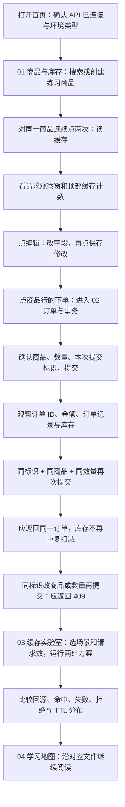
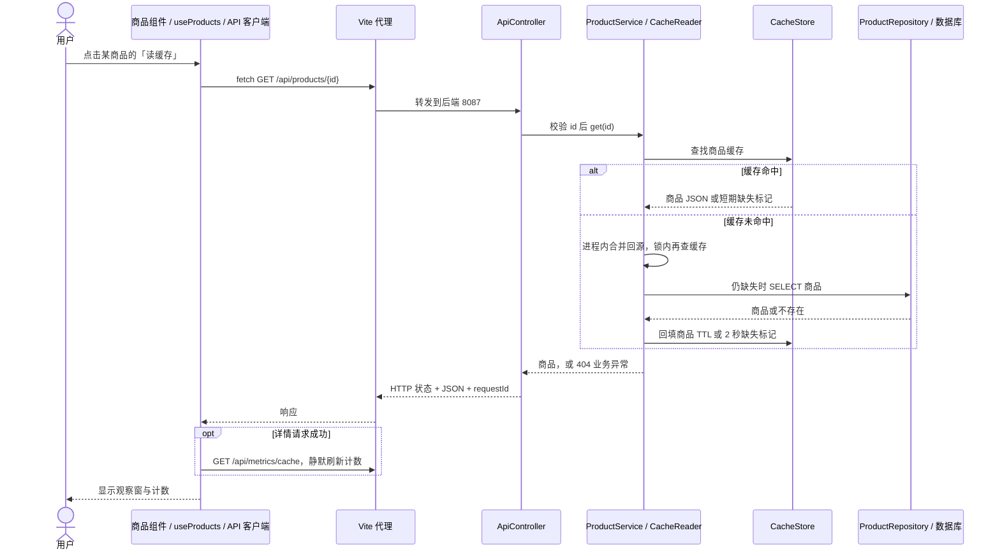
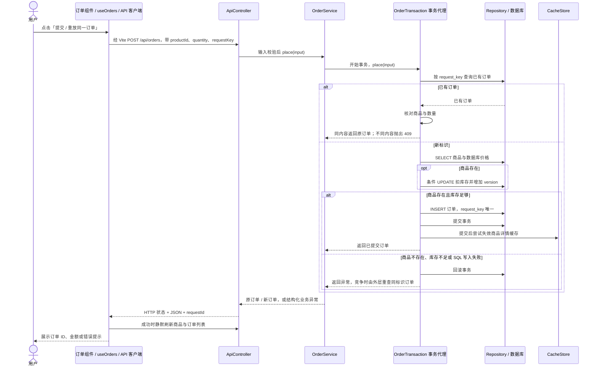

# 项目架构与使用链路：从一次点击学全栈

日期：2026-11-04。依据：当前项目源码与配置。本模块让你把页面操作、HTTP、Spring Boot、SQL、缓存和页面结果逐一对应；[完整技术架构](../architecture.md)提供组件与数据关系图。

## 怎样把技术模块和请求对应起来

架构说明现在同时提供「技术模块总图」和「业务组件调用图」。前者回答用了什么技术、各自负责什么；后者回答某次请求具体调用哪些类。先按下面的因果顺序阅读，再继续后面的页面练习：

1. Vue 的响应式状态接收表单输入，Fetch API 发出 HTTP / JSON，经 Vite 开发代理到后端。
2. Spring Boot 装配业务组件；Spring MVC 将请求交给 Controller，Jackson 转换 JSON，Bean Validation 校验输入，Filter 与异常处理器提供追踪和错误响应。
3. Service 编排业务；写入由 Spring 事务支持，SQL 条件与数据库约束执行 version、库存和唯一键规则。
4. JdbcTemplate 读写 H2 或可选 MySQL；详情请求通过 CacheReader 访问本地缓存或可选 Redis，Java 并发工具控制回源与计数。
5. 结果返回 Vue 并更新界面；Vite / Maven 负责构建，JUnit 5 / MockMvc / AssertJ 配合独立 H2 内存库验证已有业务。

练习时任选一次「读缓存」或「下单」，在两张图里找到所经过的技术模块和代码类，说明输入、SQL 或缓存访问、正常输出与异常分支。模块所用技术和源码入口已列在[技术模块清单](../architecture.md)。

## 怎样进入项目

如果服务尚未运行，在项目根目录执行 `npm run dev`；首次缺少前端依赖时先按 [README](../../README.md) 执行 `npm run setup`。打开默认前端地址 [127.0.0.1:5178](http://127.0.0.1:5178)，后端默认 8087。这里给出操作方法，本轮未执行启动。

右上角通过 `/api/system` 显示配置类型；默认显示 `h2-demo / local-demo`。`App.vue` 装配四个独立 View，`KeepAlive` 保留表单和页面状态，仍按标签切换。数据由工作区初始化、刷新与领域 composable 操作读取，组件和类型边界见[前端分层说明](frontend-typescript-components.md)。

## 推荐使用顺序

这是一条学习路线，四个标签可以自由切换。

库存为 1、下单数量为 1，适合观察「最后一件库存」：相同标识重放仍返回原订单；生成新标识再下单，应因库存不足返回 409。SKU 使用新的合法值，例如 `STUDY-001`；重复使用已存在 SKU 会触发唯一约束。

## 页面动作与接口对应

所有地址都由 `api/client.ts` 加上 `/api`，具体接口定义在 `api/lab.ts`，开发时经过 Vite 代理到 Spring Boot。页面事件经领域 composable 调用接口，数据库地址留在后端配置。

| 页面动作         | 实际请求                                              | 后端与存储                                    | 页面观察点                     |
| ------------ | ------------------------------------------------- | ---------------------------------------- | ------------------------- |
| 首次打开 / 右上角刷新 | `GET /api/system`、商品列表、订单列表、`/api/metrics/cache`  | 配置信息、Repository、当前实例详情缓存计数               | 环境类型、商品和订单总数、缓存计数         |
| 搜索 / 翻商品页    | `GET /api/products?page=0&size=8&q=...`           | ProductService → ProductRepository → SQL | 商品列表；页码在接口中从 0 开始         |
| 创建商品         | `POST /api/products`                              | 校验 → ProductService 事务 → INSERT          | 新商品出现在列表                  |
| 点击编辑         | 无 HTTP，复制当前行到表单                                   | 保留行内的 version                            | 右侧表单与提交版本                 |
| 保存修改         | `PUT /api/products/{id}`                          | 带 version 条件 UPDATE，提交后失效缓存              | 列表与版本；旧版本返回 409           |
| 读缓存          | `GET /api/products/{id}`，随后读取缓存指标                 | CacheReader → 缓存；需要时查数据库                 | 请求观察窗、hits / dbReads 增量   |
| 点击商品行的下单     | 无 HTTP，填好商品并生成 requestKey，切换订单标签                  | 前端状态变化                                   | 商品、数量、本次提交标识              |
| 提交 / 重放同一订单  | `POST /api/orders`，随后刷新商品与订单列表                    | OrderService → OrderTransaction → SQL 事务 | 订单 ID 是否相同，库存是否只扣一次       |
| 生成新订单标识      | 无 HTTP，生成新的 requestKey                            | 下一次提交视为另一次业务请求                           | 标识改变；再次提交可能再次扣库存          |
| 删除           | 确认后 `DELETE /api/products/{id}`                   | DELETE；外键保护已有订单引用                        | 成功移除，或返回 409              |
| 运行原始与保护方案    | 两次顺序 `POST /api/labs/cache/run`，先 naive 后 guarded | LabService → 独立读取器 / 缓存命名空间 / 当前数据库      | 两组实验结果；每次请求 8–60、最多 8 个线程 |
| 切换学习地图       | 无 HTTP                                            | 显示静态学习卡片                                 | 文件阅读顺序                    |

请求观察窗保留最后一次非静默请求；初始加载、背景刷新和部分翻页使用 `quiet: true`，不会逐条写入。实验运行完成后观察窗通常显示第二组 guarded 请求。需要看完整请求序列时，打开浏览器开发者工具的 Network。

成功写入后界面会刷新相关列表，不能把这些列表 SQL 算到详情回源计数里。

## 一条商品详情请求怎样走完

详情正常 TTL 基数为 30 秒，保护策略再增加抖动。连续点击时，如果缓存没有提前填充或失效，通常先看到一次回源，再看到命中增加；若已经命中，第一次点击也可能直接命中，应比较计数增量。`hits` 包含空值缓存命中；缓存命中缺失标记仍应返回 404。失败时本次函数不会继续刷新顶部指标，可用右上角「刷新」重新读取。

缓存读取故障走另一条分支：最多允许 4 个并发数据库回源，超限返回 503。缓存健康但未命中时，按 key 的进程内条带锁合并读取；这不是分布式协调。

## 一条订单请求怎样保证不重复扣库存

图中提交后失效由 `ProductService.afterCommit()` 注册的回调执行；缓存故障不会撤销已提交订单。并发产生唯一键冲突时，失败事务先回滚，`OrderService` 再查已完成订单并核对内容；库存不足的竞争分支也会重查同标识订单。这些规则最终由数据库事务、条件更新与唯一约束共同保障。

三个字段分工不同：

| 字段         | 谁生成 / 传入                  | 用途                            |
| ---------- | ------------------------- | ----------------------------- |
| requestKey | 前端生成或用户填写，放在订单请求体         | 标识同一次业务提交，重试时保持不变             |
| requestId  | 后端为每次 HTTP 请求生成，放在响应体和响应头 | 找到一次请求的追踪标识；重放会得到新的 requestId |
| version    | 数据库商品记录，前端编辑时带回           | 拒绝基于旧数据的修改，避免覆盖其他修改或下单扣库存     |

## 怎样观察异常与缓存实验

| 结果             | 意义与下一步                                                                                                |
| -------------- | ----------------------------------------------------------------------------------------------------- |
| 400            | 字段或格式不合法，按响应的 details 修改输入；浏览器可能先拦住明显无效表单                                                             |
| 404            | 商品不存在，或实验被关闭，结合 code 判断                                                                               |
| 409            | 查看 VERSION\_CONFLICT、INSUFFICIENT\_STOCK、IDEMPOTENCY\_CONFLICT 或 DATA\_CONFLICT，再重新加载、调整数量或生成真正的新订单标识 |
| 429            | 该实例已有实验在运行，结束后重试                                                                                      |
| 503            | 缓存不可用或回源预算不足，查看 code；实验内部子请求失败通常聚合在结果里                                                                |
| 网络错误 / API 未连接 | 核对后端已启动、8087 端口与 Vite 的 LAB\_API\_URL 是否匹配                                                            |

依次选择穿透、击穿、雪崩、故障，再点「运行原始与保护方案」。主要看 `dbReads`、`hits`、`negativeHits`、`cacheErrors`、`rejected` 与 `failedRequests`；雪崩还看 `seededTtlMs`。每组实验使用独立计数，不等于顶部的业务详情计数。HTTP 200 只表示实验执行完成，不代表每个子请求都成功。更多实验口径见[缓存实验手册](../cache-labs.md)。

## 跟随练习与验证边界

1. 用合法新 SKU 创建库存为 1 的商品。点击两次「读缓存」，记录两次 HTTP 响应和命中 / 回源增量。
2. 在两个浏览器页面刷新到同一版本，再各自点击编辑；页面 A 保存后，页面 B 提交旧版本，应返回 409。
3. 对练习商品下单数量 1，记下订单 ID 和标识；同标识同内容重放应仍是该 ID，库存保持 0。
4. 同标识改数量应冲突；生成新标识再下单也会因库存不足冲突。已有订单的商品删除应被外键阻止。
5. 运行一组缓存实验，说明保护方案改变的是哪条链路、哪些实际计数，以及没有解决什么。

最初图表整理完成了源码、链接和图表结构检查，未运行独立 Mermaid 渲染器。后续前端 TS 重构的类型、构建和交互回归单独见[验证记录](../verification.md)；各轮结论按实际验证范围区分。真实 MySQL/Redis 尚未实测，单进程合并回源也不能推导出多实例下相同的保障。

能够沿「页面事件 → api → Controller → Service / 事务 → Repository / CacheStore → 响应 → 页面」解释一条正常和一条异常请求，即完成本模块的学习目标。
